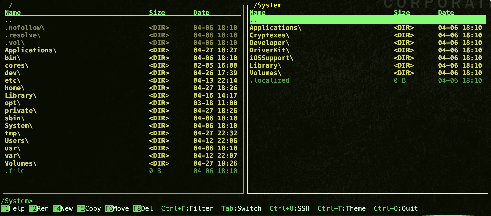

```
 ██████╗ ██████╗ ████████╗
██╔════╝ ██╔══██╗╚══██╔══╝
██║      ██████╔╝   ██║
██║      ██╔═══╝    ██║
╚██████╗ ██║        ██║
 ╚═════╝ ╚═╝        ╚═╝
```

Dual-pane TUI file explorer in the style of Total Commander, written in Rust.
Single native binary. Some features use system tools.



## Features

- Dual-pane navigation, arrow keys only
- Copy / move / rename / delete with conflict resolution
- Multi-select (Space, Ctrl+A) with size totals
- Quick filter (Ctrl+F) on the active pane
- Bookmarks panel (Ctrl+B), persisted to disk
- Drives / mounts panel (Alt+F1, Alt+F2, Ctrl+\\) for Windows drive letters and Unix mount points
- 256-color theme editor (Ctrl+T) with live preview
- Embedded text editor (Enter on a file): undo/redo, search, copy/paste
- Archive extraction: `.zip`, `.tar.*`, `.7z`, `.rar`, `.gz`, `.bz2`, `.xz`
- SSH/SFTP remote browsing (`ssh user@host`)
- Async task runner with live output window
- Session restore on launch

## Build

Requires Rust stable (edition 2024) and a 256-color terminal.

```sh
cargo build --release --locked
```

## Usage

```sh
cpt                       # restore last session
cpt /path/to/dir          # set left pane
cpt /left /right          # set both panes
cpt --debug               # write log to cpt.log
```

## Archive extraction

cpTerm checks every member before creating output files. It extracts regular
files and directories, merges existing directories, and preserves existing
files. It rejects traversal paths, links and special files. RAR, 7z and less
common ZIP codecs use the system's libarchive tar reader. On Linux, install
`bsdtar` (the `libarchive-tools` package on Debian and Ubuntu) for those formats.

An extraction can contain up to 10,000 entries, including implicit directories.
Its expanded contents can total up to 200 times the archive's size, with an
8 MiB minimum allowance and a 1 GiB maximum. cpTerm stages the contents in
temporary storage and reports a limit error before writing to the destination.

## SSH

SSH uses OpenSSH's `ssh-keygen` and your `~/.ssh/known_hosts`. For a new
server, first verify its host fingerprint with the administrator and record
the verified key using OpenSSH. Unknown, changed and revoked keys are
rejected before authentication. Ed25519 and ECDSA keys and password login
are supported; RSA and host certificates are disabled.

Uploads and downloads require a new destination filename. Remote text previews
are read-only and limited to 64 KiB; download larger files to view them locally.
An upload appears under its final name after the server confirms the file is
closed. If a connection drops, retry the same filename. A hidden
`.cpt-upload-*.part` file may remain on the server after a disconnect.

## Keybindings

| Key | Action |
|-----|--------|
| `F1` | Help |
| `F2` | Rename |
| `F3` | View in `$PAGER` |
| `F4` | New file or directory |
| `F5` | Copy to other pane |
| `F6` | Move to other pane |
| `F7` | New directory |
| `F8` / `Del` | Delete |
| `Tab` | Switch pane |
| `Enter` | Enter dir / open file in editor |
| `Space` / `Insert` | Toggle selection |
| `Ctrl+A` | Select all (toggle) |
| `Ctrl+F` | Quick filter (or search in editor) |
| `Ctrl+B` | Bookmarks panel |
| `Alt+F1` / `Alt+F2` | Drives panel (left / right pane) |
| `Ctrl+\` | Drives panel (active pane) |
| `Ctrl+T` | Theme editor |
| `Ctrl+O` | SSH connect dialog |
| `Ctrl+Z` | Minimize / restore task window |
| `Ctrl+Q` | Quit |

Type any printable character in normal mode to open an inline command line.
`cd <path>` navigates the active pane. Other commands run through the system shell in local panes.

## Configuration

Files are managed by [confy] and stored per platform:

| Platform | Path |
|----------|------|
| Linux | `~/.config/cpt/ (or $XDG_CONFIG_HOME/cpt/)` |
| macOS | `~/Library/Application Support/rs.cpt/` |
| Windows | `%APPDATA%\cpt\config\` |

| File | Contents |
|------|----------|
| `cpt.toml` | Last directories, active pane, theme |
| `bookmarks.toml` | Saved bookmarks |
| `themes/<name>.toml` | Custom themes (26 color fields) |
| `cpt.log` | Session warnings and errors; `--debug` also records diagnostics |

## License

MIT

[confy]: https://crates.io/crates/confy
